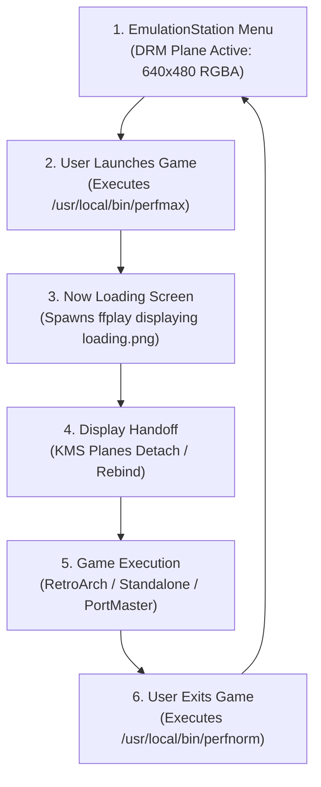

# 🕹️ R36S Hardware & ArkOS Internals

This document covers the physical hardware, chipset limitations, operating system peculiarities, and filesystem structure of the **R36S handheld console** running **ArkOS**, and explains why specific architectural choices had to be made in DevBridge.

---

## ⚙️ Hardware Specifications & Constraints

| Component | Specification | Development Implications & Quirks |
| :--- | :--- | :--- |
| **SoC** | Rockchip RK3326 | Quad-core ARM Cortex-A35 up to 1.3 GHz (overclockable to 1.5 GHz in `perfmax` mode). Power-efficient but limited out-of-order execution capacity. |
| **GPU** | ARM Mali-G31 MP2 | Supports OpenGL ES 3.2 and Vulkan 1.0. ArkOS emulators bind to Mali directly via DRM/GBM or proprietary drivers; framebuffer access requires KMS or fbdev. |
| **RAM** | 1GB DDR3 / DDR3L | Shared between system, GPU VRAM, emulators, and background daemons. Background memory footprint must stay strictly below 15 MB. |
| **Display** | 3.5" IPS LCD | **640×480 physical resolution** (4:3 aspect ratio). Often connected via DSI/DPI panel bridges. Some clone units use alternate display panels requiring DTB modifications. |
| **Storage** | Dual MicroSD (TF1/TF2) | TF1 houses bootloader and OS; TF2 typically houses ROMs (`EASYROMS`). Read/write speeds are constrained by the RK3326 SDIO bus (~20 MB/s). |
| **USB** | Dual USB-C Ports | Right port: **DC IN** (power charging only).<br>Left port: **OTG** (data & peripherals). |

---

## ⚠️ Limites do Hardware (R36S) e Armadilhas do ArkOS (O que NUNCA fazer)

O R36S usa o SoC Rockchip RK3326 (4x ARM Cortex-A35 @ 1.3–1.5GHz in-order, GPU Mali-G31 MP2 e 1GB DDR3L compartilhada) rodando um kernel Linux BSP 4.4 antigo no ArkOS.
Existem 4 armadilhas fatais nesse ambiente:

1. **A Armadilha do DRM Master (Jogo não abre / Tela Preta):**
   - No kernel 4.4 da Rockchip, quando você escolhe um jogo no EmulationStation, ele fecha/solta o vídeo e o emulador (RetroArch, PPSSPP, Drastic) tenta assumir o controle exclusivo de `/dev/dri/card0`.
   - **Regra de ouro:** Se o `r36s-agent` mantiver `/dev/dri/card0` ou um handle GEM/DMA-BUF aberto continuamente, o kernel não dispara o `drm_lastclose()` ou nega o `drmSetMaster` do emulador — o jogo trava ou volta para o menu. O comportamento atual em `DrmReader::capture` (abrir, chamar `DRM_IOCTL_DROP_MASTER`, exportar FD, copiar e fechar tudo em ~1ms) deve ser preservado intacto.

2. **Por que NÃO usar o encoder de hardware (VPU/MPP ou RGA) do RK3326:**
   - Grandes empresas usam H.264/HEVC via hardware. Porém, no RK3326 sob ArkOS, a unidade VPU (`librockchip_mpp`) e o acelerador 2D (RGA) compartilham a reserva de memória física contígua (CMA / ION) com os emuladores e com o player de vídeo (`ffplay`).
   - Se o daemon alocar contextos MPP/RGA em background, emuladores pesados (PSP, N64, Dreamcast) sofrem Out-Of-Memory na CMA ou conflito de registradores `/dev/rga`, travando o console.

3. **Coerência de Cache ARM (Dados falsos ou rasgados):**
   - A GPU Mali escreve na RAM via DMA sem avisar o cache L1/L2 da CPU.
   - Remover o `poll(dma_fd)` ou o `DMA_BUF_IOCTL_SYNC` em `framebuffer.rs:299-325` faz a CPU ler lixo do cache (faixas pretas ou tearing).

4. **USB 2.0 dwc2 + g_ether (Queda de conexão):**
   - O controlador USB OTG (`dwc2`) do RK3326 é limitado a USB 2.0 (~15–25 MB/s reais) e gera alta carga de interrupções (IRQ) no núcleo CPU0.
   - Rajadas descontroladas causam FIFO overrun e derrubam a interface `usb0`.

---

## 🐧 The ArkOS Distribution (Linux 4.4.189 aarch64)

ArkOS for the R36S is derived from Ubuntu 19.10 / Debian Buster, running an out-of-tree Rockchip vendor BSP kernel: **Linux 4.4.189-rk3326 (aarch64)**.

Because this is a legacy vendor kernel with custom vendor drivers, standard modern Linux kernel features (like modern DRM atomic modesetting, modern PipeWire capture, or modern v4l2loopback) either do not exist or behave non-standardly:

1. **Kernel Symbol Restrictions:** `/proc/kallsyms` is restricted or stripped, making kernel stack resolution difficult during diagnostics.
2. **Proprietary DRM Subsystem:** The Rockchip DRM driver (`rockchipdrm`) manages display timing and plane composition.
3. **Fbdev Emulation (`/dev/fb0`):** Provided on top of the DRM driver. As explored in [Video Pipeline](video-pipeline.md), concurrent access between DRM and fbdev has serious kernel locking pitfalls.

---

## 🛠️ The USB OTG Hardware Problem & DTB Patching

Out of the box, ArkOS configures the RK3326 USB controller in **Host Mode** (`dr_mode = "host"`), designed to attach external Wi-Fi dongles or USB keyboards via OTG adapters.

When you connect the R36S to a PC with a standard USB-C cable, nothing happens: the PC does not detect any USB device because both sides act as USB hosts (or the R36S supplies no VBUS power and listens for nothing).

### The Solution: Device Tree Patch (`patch_dtb_usb.py`)

DevBridge inspects `/boot/rk3326-r36s-linux.dtb` (compiled Device Tree Blob) and modifies the `dwc2` USB controller node:

```dts
/* Original Device Tree Node */
usb@ff580000 {
    compatible = "rockchip,rk3326-usb", "snps,dwc2";
    dr_mode = "host";        /* ❌ PC cannot see R36S */
};

/* Patched Device Tree Node */
usb@ff580000 {
    compatible = "rockchip,rk3326-usb", "snps,dwc2";
    dr_mode = "peripheral";  /* ✅ Enables USB Gadget mode */
};
```

1. **Safety First:** The script generates a SHA-256 verified backup (`original.dtb`) in `/boot/` before applying any binary byte patching.
2. **Module Auto-Loading:** The installer injects `dwc2` and `g_ether` into `/etc/modules`.
3. **Network Gadget:** When booted, the kernel activates `g_ether`, exposing an emulated Ethernet network card over USB.

---

## 🎮 The ArkOS Game Lifecycle & Display Handoff

Understanding how ArkOS launches emulators and manages the screen was vital to fixing stream freezes:



### Key Phases:

1. **`perfmax` Phase:**
   ArkOS switches CPU governors to maximum performance before starting a game:
   ```bash
   echo "performance" > /sys/devices/system/cpu/cpu0/cpufreq/scaling_governor
   ```
2. **`ffplay` Phase (Loading Screen):**
   ArkOS executes a script that runs `ffplay` to display a splash image (`loading.png`). During this split-second transition, the DRM plane assigned to EmulationStation is destroyed or unmapped, and a temporary plane is created for `ffplay`.
3. **Emulator Handshake:**
   Once `ffplay` exits, RetroArch (or a PortMaster binary) initializes its own graphics context (often via DRM/KMS directly with GLES).
4. **Resolution Changes:**
   A game might change the CRTC mode from `640x480` to `320x240` (e.g. SNES, GBA, or PS1).
5. **`perfnorm` Phase:**
   When exiting, ArkOS restores the governor to `ondemand` or `schedutil` to save battery.

> **💡 Architectural Decision:**
> If a capture agent assumes that the display plane or framebuffer memory address is permanent, it will freeze the exact moment `ffplay` terminates or RetroArch takes over DRM! DevBridge continuously queries active DRM CRTCs and dynamically adapts to resolution and plane changes every single frame.

---

## 📁 Filesystem Layout in ArkOS

ArkOS partitions the MicroSD card into three key volumes:

```
SD Card Root
├── /boot (FAT32)
│   ├── Image (Kernel binary)
│   ├── rk3326-r36s-linux.dtb (Device Tree Blob)
│   └── original.dtb (DevBridge verified backup)
├── / (ext4 - System Root)
│   ├── /usr/local/bin/r36s-agent (Installed daemon binary)
│   └── /etc/systemd/system/r36s-agent.service (Systemd unit)
└── /roms or /media/EASYROMS (exFAT / ext4)
    ├── /roms/ports/ (PortMaster & custom game scripts)
    │   ├── R36S DevBridge.sh
    │   └── r36s-devbridge/
    ├── /roms/gba/
    ├── /roms/psx/
    └── ...
```

DevBridge respects these mount points and permissions:
- During SD card installation, `install_to_sd.sh` auto-detects `EASYROMS`, `BOOT`, and `root`.
- The daemon runs as a native systemd unit with low niceness (`nice = -5`) to ensure smooth telemetry while allowing the active game priority over GPU and CPU resources.
